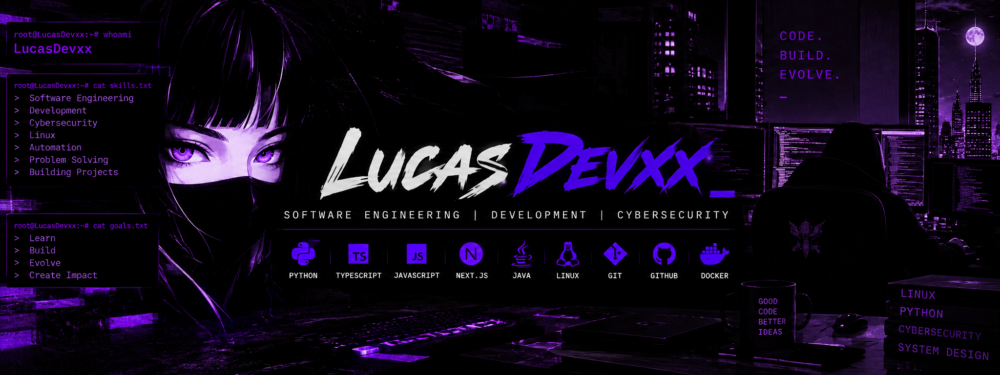

<!--
  LucasDevxx | PHANTOM PURPLE
  Profile README
-->

<!-- BANNER PRINCIPAL -->
<p align="center">
  
</p>

<!-- ANIMACAO DE TEXTO -->
<p align="center">
  
</p>

<!-- BADGES -->
<p align="center">
  
  
  
</p>

---

## Sobre mim

```text
> Software Engineering student
> Estudando programação e desenvolvimento web
> Explorando Linux, redes e cibersegurança
> Construindo conhecimento, um projeto por vez
```

---

## Desenvolvimento Web

<p align="left">
  
</p>

HTML • CSS • JavaScript • TypeScript • Next.js • Tailwind CSS

## Programação

<p align="left">
  
</p>

Python

## Sistemas e ferramentas

<p align="left">
  
</p>

Linux • Git • GitHub • Docker

---

## O que estou estudando

- Desenvolvimento web com Next.js e TypeScript
- Programação com Python
- Linux e administração de sistemas
- Redes de computadores
- Fundamentos de cibersegurança

---

## Estatísticas do GitHub

<p align="center">
  
  
</p>

<p align="center">
  
</p>

---

<!-- ENCERRAMENTO ANIMADO -->
<p align="center">
  
</p>

<p align="center">
  
</p>

<p align="center">
  
</p>
